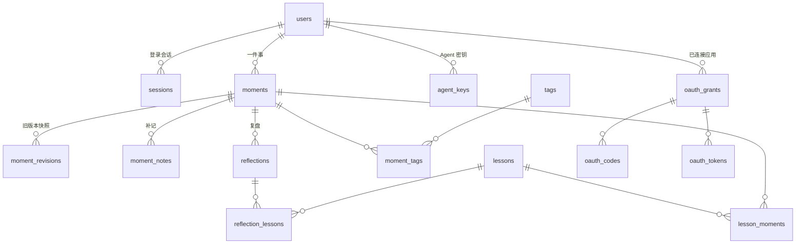

> 实现更新（2026-10-11）：后端已实现；自动回看排程已由所有者取消。本文保留原设计背景，当前行为以 [IMPLEMENTATION.md](IMPLEMENTATION.md) 为准。

# NBD 数据模型

本文件是后端的数据契约：表结构、不变量、时间表示、状态推导、复盘排程、幂等、全文检索、清理任务和统计口径。第 3 节的 DDL 是迁移 `001_init.sql` 的草案，实现时可以直接拿来用；改动表结构要走第 12 节的迁移规则。

接口字段见 [API.md](API.md) 和 [openapi.yaml](openapi.yaml)；MCP 见 [MCP.md](MCP.md)。

## 1. 总览



另外还有：`idempotency_keys`（幂等）、`oauth_clients`（CIMD 文档缓存）、`oauth_requests`（待确认的授权请求）、`audit_events`（审计）、`moment_search`（FTS5 检索）、`schema_migrations`（迁移版本）。

一件事的生命周期：

```text
Agent 记录 ──► fresh（24h 内，Agent 可更正）──► cooling（冷却中）──► due（到回看日）
                                                    ▲                   │ 写复盘
                                                    │ 结论不是 let_go     ▼
                                              reflected ◄──────────── 复盘
                                                                        │ 结论 let_go
                                                                        ▼
                                                                    settled（已释怀）
任意状态 ──归档──► archived（暂停提醒）；任意状态 ──删除──► 回收站（30 天后彻底删除）
```

## 2. 通用约定

- **连接**：每个进程一个 better-sqlite3 连接，`journal_mode=WAL`、`foreign_keys=ON`、`busy_timeout=3000`；数据目录 0750，库文件 0600（照搬 `game_site/src/db/index.ts`）。
- **主键**：UUID v4（TEXT）；`audit_events` 用自增整数，便于做游标。
- **时间**：Instant 存 epoch 毫秒（INTEGER），API 返回 UTC ISO 8601。LocalDate 存 `YYYY-MM-DD`（TEXT），字典序就是时间序。
- **JSON 列**：以 `_json` 结尾，存 TEXT；需要按内容查询时用 `json_each`。
- **user_id**：所有业务表都带 `user_id`，每条查询都带这个条件。v1 只有一个所有者，但以后开放多人时不用改表。
- **级联**：子表一律 `ON DELETE CASCADE`；事件的「删除」先是软删除（`deleted_at`），彻底删除时才级联。
- **写事务**：多语句写入一律 `BEGIN IMMEDIATE`（better-sqlite3 的 `.immediate()`），事务内不做网络请求；`SQLITE_BUSY` 映射为 503 `STORAGE_BUSY`。

## 3. 表结构（迁移 001 草案）

> 枚举值必须和 [openapi.yaml](openapi.yaml) 的枚举组件、`GET /api/v1/meta` 完全一致。长度约束用 `length()`，SQLite 对 TEXT 按字符计数，中文一个字算 1。

### 3.1 账号与会话

```sql
CREATE TABLE users (
  id TEXT PRIMARY KEY,
  username TEXT NOT NULL COLLATE NOCASE UNIQUE,
  display_name TEXT NOT NULL CHECK (length(display_name) BETWEEN 1 AND 24),
  password_hash TEXT NOT NULL,                       -- argon2id
  role TEXT NOT NULL DEFAULT 'owner' CHECK (role IN ('owner')),
  timezone TEXT NOT NULL DEFAULT 'Asia/Shanghai',     -- IANA，写入前用 Intl.supportedValuesOf('timeZone') 校验
  week_starts_on INTEGER NOT NULL DEFAULT 1 CHECK (week_starts_on BETWEEN 0 AND 6),
  password_changed_at INTEGER NOT NULL,
  created_at INTEGER NOT NULL,
  updated_at INTEGER NOT NULL
);

CREATE TABLE sessions (
  id TEXT PRIMARY KEY,
  user_id TEXT NOT NULL REFERENCES users(id) ON DELETE CASCADE,
  token_hash TEXT NOT NULL UNIQUE,                    -- SHA-256(会话令牌)
  created_at INTEGER NOT NULL,
  renewed_at INTEGER NOT NULL,                        -- 最多每 24 小时续期一次
  expires_at INTEGER NOT NULL,                        -- 闲置 30 天过期
  user_agent TEXT,
  ip TEXT
);
CREATE INDEX sessions_user ON sessions(user_id);
CREATE INDEX sessions_expiry ON sessions(expires_at);
```

### 3.2 事件（Moment）

```sql
CREATE TABLE moments (
  id TEXT PRIMARY KEY,
  user_id TEXT NOT NULL REFERENCES users(id) ON DELETE CASCADE,
  revision INTEGER NOT NULL DEFAULT 1 CHECK (revision >= 1),

  -- 原始记录（修改会生成修订记录）
  title TEXT NOT NULL CHECK (length(title) BETWEEN 1 AND 60),
  narrative TEXT NOT NULL CHECK (length(narrative) BETWEEN 1 AND 20000),
  agent_summary TEXT CHECK (agent_summary IS NULL OR length(agent_summary) BETWEEN 1 AND 500),
  happened_at INTEGER NOT NULL,                       -- day/approx 时为所有者时区当天 12:00
  happened_on TEXT NOT NULL,                          -- LocalDate，写入时算好，之后不重算
  happened_precision TEXT NOT NULL CHECK (happened_precision IN ('exact','day','approx')),
  scene TEXT NOT NULL CHECK (scene IN ('work','study','social','family','romance','online','public','other')),
  emotions_json TEXT NOT NULL,                        -- [{"key":"embarrassed","intensity":8|null}]，1–5 个，key 不重复
  intensity INTEGER NOT NULL CHECK (intensity BETWEEN 0 AND 10),
  severity INTEGER CHECK (severity BETWEEN 0 AND 10),
  feared_outcome TEXT CHECK (feared_outcome IS NULL OR length(feared_outcome) BETWEEN 1 AND 1000),
  outcome_known_by TEXT,                              -- LocalDate
  thoughts TEXT CHECK (thoughts IS NULL OR length(thoughts) BETWEEN 1 AND 2000),
  body_signals TEXT CHECK (body_signals IS NULL OR length(body_signals) BETWEEN 1 AND 500),
  immediate_response TEXT CHECK (immediate_response IS NULL OR length(immediate_response) BETWEEN 1 AND 1000),
  people_json TEXT NOT NULL DEFAULT '[]',             -- 只写角色，最多 10 个

  -- 记录信息（不随修改变化）
  captured_at INTEGER NOT NULL,
  captured_on TEXT NOT NULL,                          -- LocalDate，复盘排程的锚点
  editable_until INTEGER NOT NULL,                    -- captured_at + FREEZE_HOURS
  source_kind TEXT NOT NULL CHECK (source_kind IN ('agent_key','oauth_app','owner','system')),
  source_id TEXT,                                     -- 密钥 ID 或授权 ID；system（种子数据）为 NULL
  source_label TEXT NOT NULL,
  dedupe_fingerprint TEXT NOT NULL,                   -- 见第 9 节

  -- 排程与派生字段（复盘写入时在同一事务里更新）
  next_review_on TEXT,                                -- LocalDate；NULL 表示不再提醒
  snoozed_until TEXT,                                 -- LocalDate
  reflection_count INTEGER NOT NULL DEFAULT 0,
  latest_intensity_now INTEGER CHECK (latest_intensity_now BETWEEN 0 AND 10),
  latest_resolution TEXT CHECK (latest_resolution IN ('let_go','easing','still_matters')),

  -- 整理与修改
  archived_at INTEGER,
  deleted_at INTEGER,
  last_edited_at INTEGER,
  last_edited_by_kind TEXT,
  last_edited_by_id TEXT,
  last_edited_by_label TEXT,
  created_at INTEGER NOT NULL,
  updated_at INTEGER NOT NULL
);
CREATE INDEX moments_timeline ON moments(user_id, happened_at DESC, id) WHERE deleted_at IS NULL;
CREATE INDEX moments_review ON moments(user_id, next_review_on) WHERE deleted_at IS NULL AND archived_at IS NULL;
CREATE INDEX moments_trash ON moments(user_id, deleted_at) WHERE deleted_at IS NOT NULL;
CREATE INDEX moments_dedupe ON moments(user_id, source_id, dedupe_fingerprint, captured_at);

CREATE TABLE moment_revisions (
  id TEXT PRIMARY KEY,
  moment_id TEXT NOT NULL REFERENCES moments(id) ON DELETE CASCADE,
  revision INTEGER NOT NULL,                          -- 这份快照对应的修订号，1 = 最初的原始记录
  snapshot_json TEXT NOT NULL,                        -- 该修订号时的全部原始记录字段（CaptureSnapshot）
  changed_fields_json TEXT NOT NULL,                  -- 从这一版改到下一版时变了哪些字段
  edited_by_kind TEXT NOT NULL,
  edited_by_id TEXT,
  edited_by_label TEXT NOT NULL,
  reason TEXT,
  edited_at INTEGER NOT NULL,
  UNIQUE (moment_id, revision)
);

CREATE TABLE moment_notes (
  id TEXT PRIMARY KEY,
  moment_id TEXT NOT NULL REFERENCES moments(id) ON DELETE CASCADE,
  user_id TEXT NOT NULL REFERENCES users(id) ON DELETE CASCADE,
  body TEXT NOT NULL CHECK (length(body) BETWEEN 1 AND 5000),
  author_kind TEXT NOT NULL,
  author_id TEXT,
  author_label TEXT NOT NULL,
  created_at INTEGER NOT NULL
);
CREATE INDEX notes_moment ON moment_notes(moment_id, created_at);
```

### 3.3 复盘、经验、标签

```sql
CREATE TABLE reflections (
  id TEXT PRIMARY KEY,
  moment_id TEXT NOT NULL REFERENCES moments(id) ON DELETE CASCADE,
  user_id TEXT NOT NULL REFERENCES users(id) ON DELETE CASCADE,
  intensity_now INTEGER NOT NULL CHECK (intensity_now BETWEEN 0 AND 10),
  severity_now INTEGER CHECK (severity_now BETWEEN 0 AND 10),
  fear_came_true TEXT CHECK (fear_came_true IN ('no','partly','yes','unknown')),
  what_happened TEXT CHECK (what_happened IS NULL OR length(what_happened) BETWEEN 1 AND 2000),
  perspective TEXT CHECK (perspective IS NULL OR length(perspective) BETWEEN 1 AND 5000),
  thinking_traps_json TEXT NOT NULL DEFAULT '[]',     -- 最多 5 个，不重复
  resolution TEXT NOT NULL CHECK (resolution IN ('let_go','easing','still_matters')),
  reflected_on TEXT NOT NULL,                         -- LocalDate，写入时算好
  author_kind TEXT NOT NULL,
  author_id TEXT,
  author_label TEXT NOT NULL,
  created_at INTEGER NOT NULL,
  updated_at INTEGER NOT NULL
);
CREATE INDEX reflections_moment ON reflections(moment_id, created_at);

CREATE TABLE lessons (
  id TEXT PRIMARY KEY,
  user_id TEXT NOT NULL REFERENCES users(id) ON DELETE CASCADE,
  title TEXT NOT NULL CHECK (length(title) BETWEEN 1 AND 80),
  body TEXT NOT NULL DEFAULT '' CHECK (length(body) <= 5000),
  author_kind TEXT NOT NULL,
  author_id TEXT,
  author_label TEXT NOT NULL,
  created_at INTEGER NOT NULL,
  updated_at INTEGER NOT NULL
);
CREATE TABLE lesson_moments (
  lesson_id TEXT NOT NULL REFERENCES lessons(id) ON DELETE CASCADE,
  moment_id TEXT NOT NULL REFERENCES moments(id) ON DELETE CASCADE,
  created_at INTEGER NOT NULL,
  PRIMARY KEY (lesson_id, moment_id)
);
CREATE INDEX lesson_moments_moment ON lesson_moments(moment_id);
CREATE TABLE reflection_lessons (                     -- 复盘里 lessonIds 的来源；写入时同时补 lesson_moments
  reflection_id TEXT NOT NULL REFERENCES reflections(id) ON DELETE CASCADE,
  lesson_id TEXT NOT NULL REFERENCES lessons(id) ON DELETE CASCADE,
  PRIMARY KEY (reflection_id, lesson_id)
);

CREATE TABLE tags (
  id TEXT PRIMARY KEY,
  user_id TEXT NOT NULL REFERENCES users(id) ON DELETE CASCADE,
  name TEXT NOT NULL CHECK (length(name) BETWEEN 1 AND 20),   -- 已规范化，见第 4 节
  created_at INTEGER NOT NULL
);
CREATE UNIQUE INDEX tags_name ON tags(user_id, name COLLATE NOCASE);
CREATE TABLE moment_tags (
  moment_id TEXT NOT NULL REFERENCES moments(id) ON DELETE CASCADE,
  tag_id TEXT NOT NULL REFERENCES tags(id) ON DELETE CASCADE,
  PRIMARY KEY (moment_id, tag_id)
);
CREATE INDEX moment_tags_tag ON moment_tags(tag_id);
```

### 3.4 接入：幂等、Agent 密钥、OAuth

```sql
CREATE TABLE idempotency_keys (
  user_id TEXT NOT NULL REFERENCES users(id) ON DELETE CASCADE,
  principal_id TEXT NOT NULL,                         -- 'owner'、密钥 ID 或授权 ID
  operation TEXT NOT NULL,                            -- MCP 工具名或 REST operationId
  key TEXT NOT NULL,                                  -- clientRequestId / Idempotency-Key
  fingerprint TEXT NOT NULL,                          -- SHA-256(规范化参数，不含 key)
  response_json TEXT NOT NULL,                        -- 只存 ID 和元数据，不存正文
  expires_at INTEGER NOT NULL,                        -- 24 小时
  PRIMARY KEY (user_id, principal_id, operation, key)
);
CREATE INDEX idempotency_expiry ON idempotency_keys(expires_at);

CREATE TABLE agent_keys (
  id TEXT PRIMARY KEY,
  user_id TEXT NOT NULL REFERENCES users(id) ON DELETE CASCADE,
  label TEXT NOT NULL CHECK (length(label) BETWEEN 1 AND 40),
  prefix TEXT NOT NULL,                               -- nbd_ak_ + 前 4 位，只用于辨认
  token_hash TEXT NOT NULL UNIQUE,                    -- SHA-256 hex(完整密钥)
  scopes_json TEXT NOT NULL,                          -- ["read","write"] 的非空子集
  created_at INTEGER NOT NULL,
  expires_at INTEGER NOT NULL,                        -- 1–365 天，必须有到期时间
  last_used_at INTEGER,                               -- 最多每分钟更新一次
  revoked_at INTEGER
);

CREATE TABLE oauth_clients (                          -- CIMD 元数据文档缓存（24 小时）
  client_id TEXT PRIMARY KEY,                         -- 文档自身的 https 地址
  client_name TEXT,
  redirect_uris_json TEXT NOT NULL,
  metadata_json TEXT NOT NULL,
  fetched_at INTEGER NOT NULL,
  expires_at INTEGER NOT NULL
);
CREATE TABLE oauth_requests (                         -- 确认页上待处理的授权请求（10 分钟）
  id TEXT PRIMARY KEY,
  client_id TEXT NOT NULL,
  redirect_uri TEXT NOT NULL,
  state TEXT,
  code_challenge TEXT NOT NULL,                       -- 只接受 S256
  scopes_json TEXT NOT NULL,
  resource TEXT NOT NULL,
  csrf_hash TEXT NOT NULL,
  created_at INTEGER NOT NULL,
  expires_at INTEGER NOT NULL
);
CREATE TABLE oauth_grants (                           -- 「已连接的应用」
  id TEXT PRIMARY KEY,
  user_id TEXT NOT NULL REFERENCES users(id) ON DELETE CASCADE,
  client_id TEXT NOT NULL,
  client_name TEXT NOT NULL,
  redirect_host TEXT NOT NULL,
  scopes_json TEXT NOT NULL,
  created_at INTEGER NOT NULL,
  last_used_at INTEGER,
  revoked_at INTEGER
);
CREATE UNIQUE INDEX oauth_grants_active ON oauth_grants(user_id, client_id) WHERE revoked_at IS NULL;
CREATE TABLE oauth_codes (
  code_hash TEXT PRIMARY KEY,
  grant_id TEXT NOT NULL REFERENCES oauth_grants(id) ON DELETE CASCADE,
  client_id TEXT NOT NULL,
  redirect_uri TEXT NOT NULL,
  code_challenge TEXT NOT NULL,
  scopes_json TEXT NOT NULL,
  resource TEXT NOT NULL,
  expires_at INTEGER NOT NULL,                        -- 60 秒
  used_at INTEGER                                     -- 只能用一次
);
CREATE TABLE oauth_tokens (
  id TEXT PRIMARY KEY,
  grant_id TEXT NOT NULL REFERENCES oauth_grants(id) ON DELETE CASCADE,
  kind TEXT NOT NULL CHECK (kind IN ('access','refresh')),
  token_hash TEXT NOT NULL UNIQUE,
  scopes_json TEXT NOT NULL,
  resource TEXT NOT NULL,                             -- 受众，必须等于 MCP 地址
  created_at INTEGER NOT NULL,
  expires_at INTEGER NOT NULL,
  last_used_at INTEGER,
  revoked_at INTEGER,
  replaced_by TEXT                                    -- 刷新令牌轮换后指向新令牌；旧令牌再出现即视为重放
);
CREATE INDEX oauth_tokens_grant ON oauth_tokens(grant_id);
```

### 3.5 审计与检索

```sql
CREATE TABLE audit_events (
  id INTEGER PRIMARY KEY AUTOINCREMENT,
  user_id TEXT,                                       -- 登录失败等场景可能为 NULL
  started_at INTEGER NOT NULL,
  finished_at INTEGER,
  channel TEXT NOT NULL CHECK (channel IN ('web','mcp','oauth','cli','system')),
  actor_kind TEXT NOT NULL CHECK (actor_kind IN ('owner','agent_key','oauth_app','system','anonymous')),
  actor_id TEXT,
  actor_label TEXT NOT NULL,
  action TEXT NOT NULL,                               -- 例如 moment.record、auth.login
  target_type TEXT,
  target_id TEXT,
  status TEXT NOT NULL CHECK (status IN ('running','success','error')),
  error_code TEXT,
  ip TEXT,
  request_id TEXT
);
CREATE INDEX audit_user ON audit_events(user_id, id DESC);

CREATE VIRTUAL TABLE moment_search USING fts5(
  moment_id UNINDEXED,
  user_id UNINDEXED,
  title,
  body,                                               -- 原话 + 概括 + 担心 + 想法 + 全部补记 + 全部复盘文字
  tokenize = 'trigram'
);
```

`schema_migrations(version INTEGER PRIMARY KEY, applied_at INTEGER NOT NULL)` 由迁移器自己创建，不写在 001 里。

## 4. 不变量

实现和代码评审都按这张清单逐条核对：

1. **每条查询都带 `user_id`**，包括单用户的 v1。
2. **改原始记录必须在同一个事务里做完**：写一行 `moment_revisions`（旧快照）→ 更新 `moments`（`revision + 1`、`last_edited_*`）→ 重建这条事件的检索索引 → 写审计。拿不到 `expectedRevision` 或不一致时，什么都不写。
3. **Agent 只能在 `now < editable_until` 时改原始记录**；所有者不受这个限制，但同样留修订记录。
4. **复盘的新建、修改、删除**都在同一事务里重算 `reflection_count`、`latest_intensity_now`、`latest_resolution`、`next_review_on`；新建复盘时清空 `snoozed_until`。
5. **审计只记谁、何时、做了什么、结果**，不记参数、正文和令牌。
6. **MCP 没有任何删除路径**。补记、复盘、经验、事件的删除只能在网页上做。
7. **只写主体**（只有 `write` 作用域）只能操作 `source_id = 自己` 的事件；碰别人的事件返回和「不存在」一样的错误；它的响应里不回显正文。
8. **令牌、会话、授权码只存 SHA-256**；密码只存 argon2id。
9. **统计和列表默认排除回收站**（`deleted_at IS NULL`）；只有 `getMoment`、回收站接口和导出能看到回收站里的事件。
10. **标签名在写入前规范化**：去首尾空白、去开头的 `#`、Unicode NFKC，长度 1–20；规范化后重名视为同一个标签（拉丁字母不分大小写）。

## 5. 时间表示与换算

| 字段 | 类型 | 怎么来 | 之后会不会变 |
|---|---|---|---|
| `captured_at` | Instant | 服务器时钟（`config.now()`） | 不变 |
| `captured_on` | LocalDate | `captured_at` 按**当时**的所有者时区换算 | 不变 |
| `happened_at` | Instant | 输入带偏移的时间直接换算；只有日期时取所有者时区当天 12:00 | 只随修改变化 |
| `happened_on` | LocalDate | 输入是日期就直接用；输入带偏移就按**输入的偏移**取日期 | 只随修改变化 |
| `reflected_on` | LocalDate | 复盘写入时按当时的所有者时区换算 | 不变 |
| `next_review_on`、`snoozed_until`、`outcome_known_by` | LocalDate | 排程函数、推迟、输入 | 按规则变化 |

- 「今天」= 用所有者**当前**时区把 `config.now()` 换算成 LocalDate。改时区只影响「今天」，已存的 LocalDate 一律不重算。
- 换算用 `Intl.DateTimeFormat('en-CA', {timeZone, year:'numeric', month:'2-digit', day:'2-digit'})`；LocalDate 加减天数用「当作 UTC 午夜的日期」做算术，避免夏令时干扰。
- `happenedAt` 比现在晚 10 分钟以上，返回 400 `HAPPENED_AT_IN_FUTURE`。
- 前端和 Agent 都不要用 `new Date('YYYY-MM-DD')` 解析 LocalDate（会被当成 UTC 午夜，换到 UTC+8 就是早上 8 点，换到西半球会变成前一天）。

## 6. 状态推导

状态不入库，每次读取时由后端推导：列表要按状态过滤和计数，所以 SQL 和 TypeScript 各实现一遍，两边用同一张测试向量表对拍。

```sql
-- :now = config.now()（毫秒），:today = 所有者时区的今天（LocalDate）
CASE
  WHEN m.archived_at IS NOT NULL THEN 'archived'
  WHEN m.latest_resolution = 'let_go' THEN 'settled'
  WHEN m.next_review_on IS NOT NULL AND m.next_review_on <= :today THEN 'due'
  WHEN :now < m.editable_until THEN 'fresh'
  WHEN m.reflection_count > 0 THEN 'reflected'
  ELSE 'cooling'
END
```

回收站里的事件（`deleted_at IS NOT NULL`）不参与推导，只出现在回收站接口里。

测试向量（`now = 2026-10-11T12:00:00Z`，时区 Asia/Shanghai，`today = 2026-10-11`）：

| # | archived_at | latest_resolution | next_review_on | editable_until | reflection_count | 期望 |
|---|---|---|---|---|---|---|
| 1 | 有 | let_go | 2026-10-01 | 已过 | 2 | archived |
| 2 | — | let_go | NULL | 已过 | 1 | settled |
| 3 | — | easing | 2026-10-11 | 已过 | 1 | due |
| 4 | — | — | 2026-10-09 | 已过 | 0 | due（过期 2 天） |
| 5 | — | — | 2026-10-14 | 2026-10-12T01:02Z | 0 | fresh |
| 6 | — | — | 2026-10-11 | 2026-10-12T01:02Z | 0 | due（due 优先于 fresh） |
| 7 | — | still_matters | 2026-11-27 | 已过 | 2 | reflected |
| 8 | — | still_matters | NULL | 已过 | 3 | reflected（排程走完但还在意） |
| 9 | — | — | 2026-10-14 | 已过 | 0 | cooling |

## 7. 复盘排程

`next_review_on` 由一个纯函数算出，在记录、写/改/删复盘、推迟、取消推迟时调用。**这个函数由所有者在 P1 亲手实现**（见 [BACKEND-GUIDE.md](BACKEND-GUIDE.md) 第 12 节），本节只规定契约。

```ts
type LocalDate = string; // YYYY-MM-DD
type Resolution = 'let_go' | 'easing' | 'still_matters';

interface ScheduleInput {
  capturedOn: LocalDate;                // 锚点：记录当天
  scheduleDays: readonly number[];      // 默认 [3, 14, 60]，来自 REVIEW_SCHEDULE_DAYS
  intensity: number;                    // 当时的强度 0–10，可用于按强度调整节奏
  reflections: ReadonlyArray<{ reflectedOn: LocalDate; resolution: Resolution; intensityNow: number }>; // 按时间升序
  snoozedUntil: LocalDate | null;
  outcomeKnownBy: LocalDate | null;
}
export function computeNextReviewOn(input: ScheduleInput): LocalDate | null;
```

不管选哪种节奏，都必须满足下面这些约束（它们也是公共测试向量）：

| # | 条件 | 期望 |
|---|---|---|
| C1 | 最近一次复盘的结论是 `let_go` | `null` |
| C2 | `snoozedUntil` 晚于按节奏算出的日期 | 返回 `snoozedUntil` |
| C3 | 还没有复盘、`outcomeKnownBy` 有值 | 结果不早于 `outcomeKnownBy` 的第二天 |
| C4 | 同样的输入 | 同样的输出（纯函数，不读时钟、不读数据库） |
| C5 | 有返回值时 | 是合法的 LocalDate，且不早于 `capturedOn` |

归档不是输入：归档只靠状态优先级屏蔽提醒（`archived` 排在 `due` 前面），取消归档后，过去的 `next_review_on` 自然就是「该回看」。

> 文档和示例里的日期按「从记录日起第 3/14/60 天」举例（例如 9 月 28 日记录、10 月 2 日复盘后，下次是 10 月 12 日）。如果所有者最后选了别的节奏，P1 完成后要同步更新示例。

## 8. 冻结、修订与乐观并发

- `editable_until = captured_at + FREEZE_HOURS`（默认 24 小时），只看记录时间，**不会**因为修改而延长。
- 原始记录字段（`CaptureSnapshot` 里的那些）有任何变化：
  1. 先把**修改前**的整组字段写进 `moment_revisions(revision = 当前 revision)`，`changed_fields_json` 记下这次改了哪些字段；
  2. 再更新 `moments`，`revision + 1`。
  所以 `revision = 1` 的快照永远是最初的原始记录；从没改过的事件没有修订行。
- 网页 `PATCH` 和 MCP `correct_moment` 都必须带 `expectedRevision`，不一致返回 409 `MOMENT_CONFLICT`（`details.currentRevision`）。
- 只有标签、归档、推迟、回收站这类整理操作不产生修订记录。

## 9. 幂等与去重

**幂等键**（MCP 的 `clientRequestId`、REST 的 `Idempotency-Key` 头）：
- 唯一键 `(user_id, principal_id, operation, key)`，保留 24 小时。
- `fingerprint` = 规范化参数（去掉 key 本身，按键名排序的 JSON）的 SHA-256。
- 同键同参数：返回存下的结果，MCP 结果里 `replayed: true`。同键不同参数：409 `IDEMPOTENCY_CONFLICT`。
- **只存成功的结果**，所以校验失败后修正参数、用同一个键重试是可以的。
- 幂等记录和业务写入在同一个事务里提交。

**内容去重**（模型重试时经常换一个新的 `clientRequestId`）：
- `dedupe_fingerprint` = SHA-256(NFKC(原话) 去掉所有空白 + `|` + `happened_on`)。
- `record_moment` 写入前，查同一 `user_id`、同一 `source_id`、同一指纹、`captured_at` 在 24 小时内、不在回收站的事件；找到了就直接返回它，并标 `replayed: true`。
- 只在同一个主体内去重：跨主体去重会泄露「某段话是否已经存在」。

## 10. 全文检索

- 表：`moment_search`（FTS5，`trigram` 分词器）。本机已实测：better-sqlite3 13.0.3 自带 SQLite 3.53.4，3 个字及以上的中文子串能命中；2 个字的 MATCH 查不到。
- 每次写入事件、补记、复盘（新建、修改、删除）时，在**同一个事务**里先删掉这条事件的索引行，再插入一行新的。
- 查询处理：
  1. 用户输入按空白切成词，最多 5 个词，每个词都按**字面短语**处理（把 `"` 转义成 `""` 再加引号），多个词之间是 AND。
  2. 全部词都 ≥3 个字时用 `MATCH`；只要有一个词不足 3 个字，就整体退回 `LIKE '%词%' ESCAPE '\'`（转义 `%`、`_`、`\`），扫描 `title || body`。个人数据量下这足够快。
  3. `matchSnippet` 用 `snippet()`（MATCH 时）或者在命中位置前后各截 30 个字（LIKE 时）。
- 检索结果同样排除回收站，并带 `user_id` 条件。

## 11. 定时清理

进程内每小时跑一次（照 game_site 的做法），每项一个短事务：

| 任务 | 规则 |
|---|---|
| 彻底删除回收站 | `deleted_at < now - TRASH_DAYS`（默认 30 天）：删除事件，级联补记、复盘、修订、关联，并删除检索索引行；审计记一条 `moment.purge`（system） |
| 过期会话 | `expires_at < now` |
| 过期幂等键 | `expires_at < now` |
| OAuth 临时数据 | 过期的 `oauth_requests`；用过或过期超过 1 天的 `oauth_codes`；过期或撤销超过 7 天的 `oauth_tokens`（留 7 天用于识别刷新令牌重放） |
| 审计 | 早于 `AUDIT_RETENTION_DAYS`（默认 365 天）的记录 |

## 12. 迁移规则

照搬 game_site：
- 文件 `src/db/migrations/NNN_name.sql`，版本号取文件名前缀；每个文件一个 `.immediate()` 事务，写入 `schema_migrations`。
- **迁移只在部署时运行**（`npm run migrate`，由 `deploy/install.sh` 在停服务、备份之后调用），服务启动时只用 `assertMigrated` 检查 `MAX(version) === schemaVersion`。`schemaVersion` 是代码里手动维护的常量，每加一个迁移就加一。
- 已经上线的迁移文件不能再改，修正一律写新的迁移。
- 构建时把 `.sql` 文件复制进 `dist`。

## 13. 统计口径（洞察）

所有统计都排除回收站，归档的计入；`from`/`to` 按 `happened_on` 过滤（含两端）。每个比率都带样本数，`minSample = 5`。

| 指标 | 口径 |
|---|---|
| `fear.withFear` | 写了 `feared_outcome` 的事件数 |
| `fear.no/partly/yes` | 每件事取**最近一次不是 `unknown`** 的 `fear_came_true` |
| `fear.unknown` | 复盘过，但所有回答都是 `unknown` 或没填 |
| `fear.pending` | 还没复盘过 |
| `fear.neverHappenedRate` | `no ÷ (no + partly + yes)`；分母为 0 时为 `null` |
| `intensity.pairs` | 至少复盘过一次的事件数 |
| `intensity.meanThen / meanNow` | 这些事件的 `intensity` 平均值 / 最近一次 `intensity_now` 的平均值 |
| `letGo.medianDays` | 有 `let_go` 复盘的事件，从 `happened_on` 到**第一次** `let_go` 的 `reflected_on` 相差的天数，取中位数 |
| `distributions.emotions/scenes` | 每件事计一次 |
| `distributions.thinkingTraps` | 每件事所有复盘里标过的陷阱取并集，每件事每个陷阱计一次 |
| `distributions.resolutions` | 每件事最近一次复盘的结论 |
| 衰减曲线 | 每件事一个「当时」点（`dayOffset = captured_on − happened_on`，因为当时的强度是在记录那天打的分）加每次复盘一个点（`dayOffset = reflected_on − happened_on`）；分桶 0–1、2–7、8–30、31–90、91+ 天 |
| 日历 | 按 `happened_on` 分组，`count` 是件数，`maxIntensity` 是当天各事件 `intensity` 的最大值 |
